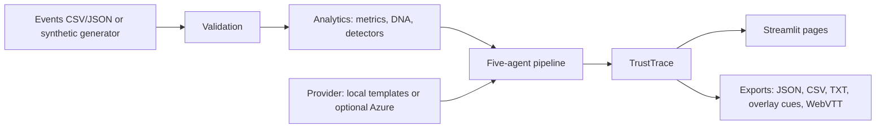
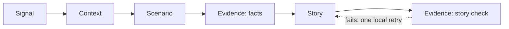

# SHIFTCAST AI — Explainable Football Intelligence & Storytelling Engine

> *Every event has a story. Every decision changes the game.*

Built for the Microsoft × Premier League "Inside the Game" Developer Hackathon 2026.
**Not an official Premier League product. All data is synthetic and fictional.**

## 1. What it is
A Streamlit app that reads football event data, finds statistically notable turning points, shows the evidence behind each one, explores "what if" alternatives, and writes stories (English + Tamil) whose every factual claim is verified by code (TrustTrace) before it is shown. It runs fully offline with no API keys.

## 2. Problem
Football stories are easy to generate and hard to trust. Fans and analysts want to know *why* a moment mattered and *whether the words match the data*.

## 3. Solution
Detect → explain with evidence ids → relate events honestly (temporal / statistical / recorded, never "caused") → offer heuristic alternatives → write stories → verify every claim against the events.

## 4. Features
| Feature | Where |
|---|---|
| Match Center (filters, play/pause/step, SYNTHETIC indicator) | page 1 |
| Match DNA (team style comparison) | page 2 |
| Turning-Point Detector (rule, p-value, strength heuristic, caveats, evidence ids) | `src/analytics/turning_points.py` |
| Impact Graph | page 3 |
| What-If Lab (2 alternatives, labelled heuristic) | page 4 |
| TrustTrace claim verification | `src/verification/` |
| Story Studio (FAN / ANALYST / BROADCAST, EN + TA, recap, exports) | page 5 |
| Synthetic Match Lab (planted ground truth, missing/contradictory data) | `src/data/generator.py` |
| Evaluation page | page 6 |
| Optional Azure OpenAI / Foundry provider | `src/providers/azure_provider.py` |

## 5. Architecture


## 6. Agent design
Five **logical** agents with structured (Pydantic) handoffs. Four are deterministic; only the Story agent may call a language model. This is a modular pipeline, not five autonomous LLMs.

Bounded and acyclic; every step is logged as an `AgentTrace`; an agent exception becomes an error trace and the pipeline continues; a provider failure or malformed/unverifiable AI output falls back to local templates with a recorded reason.

## 7. Detection methods
Sliding windows (10–15 min per rule). Binomial/Poisson rate or share tests against the rest of the match; the smallest p-value per overlapping run is kept. Rules: turnover_spike, shot_surge, defensive_cluster, flank_overload, possession_shift (exploratory). "Evidence strength" = min(1, −log10 p / 6) — **a heuristic, not a probability.** p-values are *not* corrected for multiple windows (stated in each insight's caveats).

## 8. Impact Graph
Edges are typed `recorded_outcome`, `temporal`, or `statistical` (with in-window vs outside-window rates). It never asserts causation.

## 9. What-If Lab
Rule-based alternatives with Wilson intervals. Measured and hypothetical columns are separated; assumptions and missing data are listed. Labelled **heuristic**, not a prediction.

## 10. TrustTrace
Structured claims (event_exists, count, score, metric, window_stat, player_team) are checked in code against the events. Free text is checked by an extractor that also rejects invented numbers, ids and names. Non-factual (interpretive) sentences are labelled as such. Every generated story is re-verified after generation.

## 11. Story Studio
FAN / ANALYST / BROADCAST modes × English / Tamil; recap for first half / second half / full match; broadcast mode adds graphics suggestions and overlay cues.

## 12. Synthetic data
Fictional teams (Harbour City, Northgate United, Riverside Rovers, Castle Park FC) and players. Seeded and reproducible. Ground-truth patterns are planted; fault injection adds duplicates, bad timestamps, missing values, unknown ids and a wrong final score.

## 13. Requirements
Windows 10/11, Python 3.10+ (3.11/3.12 fine), VS Code optional.

## 14. Setup (Windows PowerShell)
```powershell
Expand-Archive .\SHIFTCAST_AI_Hackathon.zip -DestinationPath .
cd .\shiftcast-ai
python -m venv .venv
.\.venv\Scripts\Activate.ps1
pip install -r requirements.txt
```
If activation is blocked: `Set-ExecutionPolicy -Scope Process -ExecutionPolicy Bypass`.

## 15. Run
```powershell
streamlit run app.py
```
Opens at http://localhost:8501.

## 16. Tests
```powershell
pip install -r requirements-dev.txt
python -m pytest -q
python scripts/run_checks.py     # no extra packages needed
```

## 17. Regenerate demo data
```powershell
python scripts/generate_demo_data.py
```

## 18. Optional Azure provider
```powershell
pip install -r requirements-azure.txt
copy .env.example .env     # then edit .env with YOUR values
```
Variables: `AZURE_OPENAI_ENDPOINT`, `AZURE_OPENAI_API_KEY`, `AZURE_OPENAI_DEPLOYMENT`, `AZURE_OPENAI_API_VERSION`. Tick "Use Azure AI" in the sidebar. **The Azure path has never been run against a live service** — only its failure/fallback behaviour is tested.

## 19. Exports
Report JSON (`shiftcast-report/1.0`), events CSV, text summary, overlay cues (`shiftcast-overlay-cues/1.0`, see `docs/OVERLAY_FORMAT.md`), WebVTT. A sample is in `data/`.

## 20. Evaluation (measured here, synthetic data)
Planted-pattern detection, rules scored: turnover_spike, flank_overload, shot_surge, defensive_cluster.
| Seeds | Precision | Recall | F1 | False alarms / control match |
|---|---|---|---|---|
| Held-out 100–119 (not used for tuning) | 0.53 | 0.73 | 0.62 | 1.7 |
| Development 1–10 (used for tuning) | 0.54 | 0.73 | 0.62 | 0.7 |

Honest reading: the detector finds about three quarters of planted patterns but roughly half of what it reports is a false alarm (flank_overload is the noisiest; shot_surge recall is weakest). The same authors wrote the generator and the detectors, so this is **not** evidence of accuracy on real data. The validator found all injected faults and TrustTrace caught 8/8 false and accepted 5/5 true statements of an author-written regression set (not a benchmark of arbitrary text).

## 21. Security
No secrets in code; `.env` is git-ignored and excluded from the ZIP; `.env.example` has placeholders only; exports never include environment values (tested).

## 22. Limitations
- Synthetic data only; no real-match validation.
- Heuristics and thresholds are hand-set; p-values uncorrected for multiple windows.
- Demo presets show some false alarms by design of the statistics.
- Tamil templates need native-speaker review.
- What-If is a rule-based illustration, not a predictive model.

## 23. What was and was not verified (build environment)
| Item | Status |
|---|---|
| 139 logic tests (analytics, validation, agents, TrustTrace, exports, translation) | **Passed** using a small stand-in runner, because pytest could not be installed in the build sandbox. They are written as plain pytest tests; please run `python -m pytest -q` yourself. |
| `scripts/run_checks.py` | Passed |
| Streamlit UI | **Not run in a real browser** (streamlit/plotly not installable in the sandbox). Syntax-checked and exercised with a mock Streamlit that ran every page for every demo match, mode and language without exceptions. Expect possible cosmetic or version issues on first run. |
| Azure provider | Not tested live |
| Deployment | None |

## 24. Credits and licence
MIT licence. Fictional teams and players. Not affiliated with or endorsed by the Premier League or Microsoft.
